# 熊猫超市智能库存管理系统 — 操作指南

> 本指南面向超市日常使用人员（管理员和普通员工），用简单易懂的语言和配图说明系统的每个功能如何操作。  
> 如有疑问，请联系系统管理员。

---

## 目录

1. [登录系统](#1-登录系统)
2. [系统界面介绍](#2-系统界面介绍)
3. [仪表盘（首页）](#3-仪表盘首页)
4. [发票识别（上传发票）](#4-发票识别上传发票)
5. [发票列表（查看和管理发票）](#5-发票列表查看和管理发票)
6. [库存管理](#6-库存管理)
7. [库存盘点](#7-库存盘点)
8. [产品管理](#8-产品管理)
9. [供应商管理](#9-供应商管理)
10. [数据分析](#10-数据分析)
11. [智能助手](#11-智能助手)
12. [通知中心](#12-通知中心)
13. [系统设置（仅管理员）](#13-系统设置仅管理员)
14. [用户管理（仅管理员）](#14-用户管理仅管理员)
15. [常见问题](#15-常见问题)

---

## 1. 登录系统

打开浏览器，在地址栏输入系统网址，会看到登录页面。

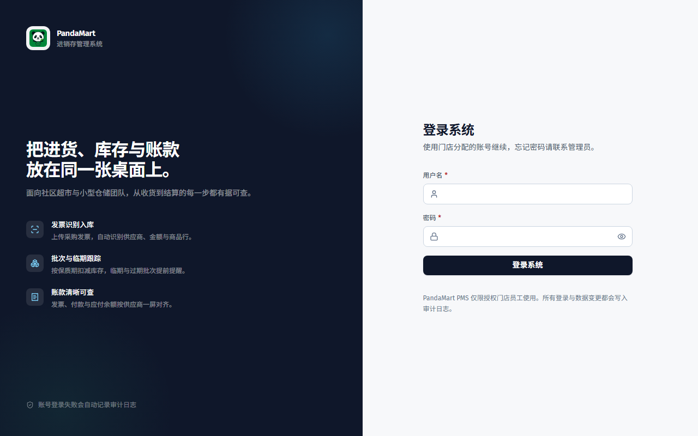

**操作步骤：**

1. 在 **用户名** 输入框中输入你的用户名（例如 `admin`）
2. 在 **密码** 输入框中输入你的密码
3. 点击红色的 **「登录系统」** 按钮
4. 登录成功后会自动跳转到仪表盘首页

**注意事项：**
- 如果连续输错密码 5 次，账户会被锁定 15 分钟，请耐心等待后重试
- 如果忘记密码，请联系管理员重置
- 系统初始化密码由管理员部署时单独配置，首次登录后建议立即修改

---

## 2. 系统界面介绍

登录后，你会看到系统的主界面，分为三个区域：

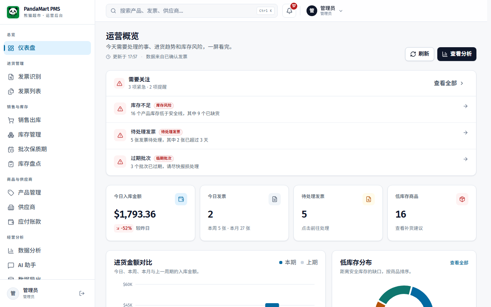

### 左侧导航栏

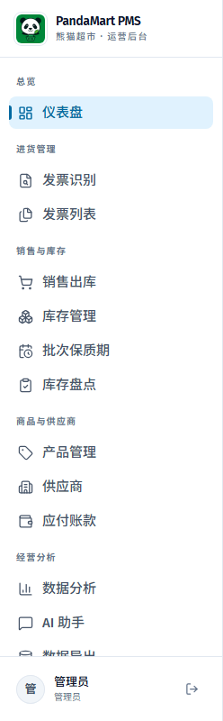

左侧红色区域是导航菜单，点击不同的菜单项可以切换到不同的功能页面：

| 菜单名称 | 功能说明 | 谁可以用 |
|---------|---------|---------|
| 仪表盘 | 首页概览，查看今日数据和预警 | 仅管理员 |
| 发票识别 | 上传发票文件，AI 自动识别内容 | 所有人 |
| 发票列表 | 查看和处理发票；店员仅能查看待处理发票 | 所有人 |
| 库存管理 | 查看当前库存；手动调整仅管理员 | 所有人 |
| 库存盘点 | 进行月度/周度盘点 | 仅管理员 |
| 产品管理 | 查看产品基础信息；增删改和价格历史仅管理员 | 所有人 |
| 供应商 | 查看供应商基础信息；维护操作仅管理员 | 所有人 |
| 数据分析 | 查看采购趋势、排名、价格波动 | 仅管理员 |
| 智能助手 | 用日常语言问库存问题、看库存预警 | 仅管理员 |
| 数据导出 | 导出数据报表 | 仅管理员 |
| 审计日志 | 查看操作记录 | 仅管理员 |
| 系统设置 | 配置系统参数和 AI | 仅管理员 |
| 用户管理 | 添加/管理用户账户 | 仅管理员 |

### 顶部栏

顶部栏显示：
- **当前登录用户**（如「管理员 · 管理员」）
- **通知铃铛** 🔔 — 红色数字表示有未读通知，点击可进入通知中心
- **退出按钮** — 点击退出登录

---

## 3. 仪表盘（首页）

> 本页面仅管理员可见。店员登录后会直接进入「发票识别」页面。

仪表盘是系统首页，登录后自动显示。它提供当天和近期的关键数据概览。

### 四张统计卡片

页面顶部有 4 张卡片，一目了然地显示关键指标：

| 卡片 | 含义 |
|------|------|
| **今日入库金额** | 今天已确认入库的发票总金额 |
| **今日发票数** | 今天处理的发票数量 |
| **待处理发票** | 还没有审核的发票数量（需要尽快处理） |
| **低库存告警** | 库存低于安全线的产品数量（需要尽快补货） |

### 金额趋势图

左侧的柱状图展示"今日 / 本周 / 本月"的入库金额对比，帮助你了解采购节奏。

### 低库存产品占比

右侧的饼图展示哪些产品库存最紧张，占比越大说明缺货越严重。

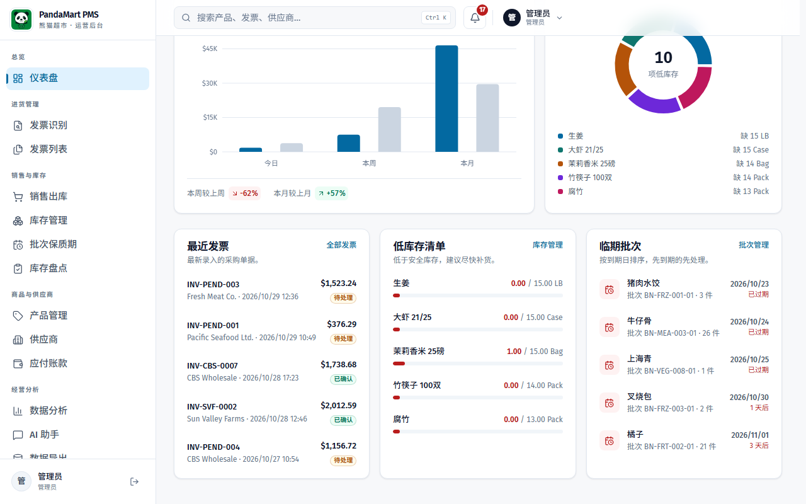

### 最近发票

列出最新的几张发票，包括发票号、供应商、金额和状态（待处理/已确认/已驳回）。

### 低库存清单

列出所有低于安全库存的产品，显示「当前数量 / 安全库存」。看到这里的产品，意味着需要尽快联系供应商补货。

---

## 4. 发票识别（上传发票）

这是系统最核心的功能之一。收到供应商的发票（扫描件、PDF 或 Excel）后上传到系统，系统会自动识别发票内容并整理成明细，等你核对后入库。

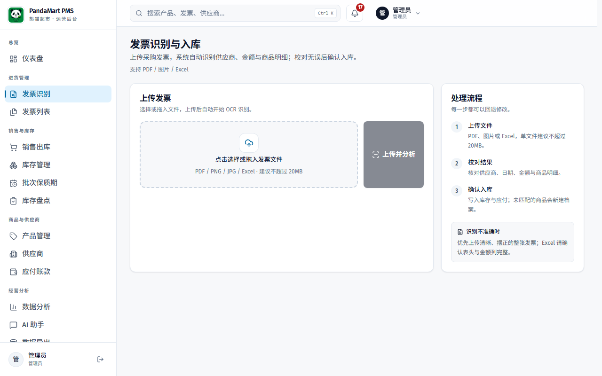

### 4.1 识别方式

系统**默认不需要任何 AI API**：

| 文件类型 | 识别方式 | 说明 |
|---------|---------|------|
| Excel | Excel 解析 | 直接读取表格，最准确 |
| 带文字层的 PDF | PDF 文本解析 | 用规则提取表头、明细、金额 |
| 图片 / 扫描版 PDF | 本地 OCR | 服务器用 Tesseract 识别文字，再整理成明细 |
| 难例（可选） | AI 视觉/文本 | 配置了 AI 提供商且本地置信度低时才使用，失败会自动回退本地 |

管理员可在 **系统设置 → 发票识别模式** 选择：

- **自动（推荐）** — 本地优先，识别不确定时才调用 AI
- **仅本地** — 完全不调用 AI，适合没有 API Key 或要求离线的环境
- **LLM 优先** — 保持原来的 AI 优先流程

> 本地 OCR 需要服务器安装 Tesseract 与 poppler。管理员可在设置页看到「本地 OCR：可用 / 未安装」；未安装时图片和扫描件会提示联系管理员，PDF 文本和 Excel 不受影响。

### 4.2 操作步骤

1. 点击左侧菜单的 **「发票识别」**
2. 在上传区域点击或拖拽文件上传
3. 支持的文件格式：
   - **PDF 文件**（有文字层的 PDF 最准确）
   - **图片文件**（JPG / PNG — 拍照或扫描的发票）
   - **Excel 文件**（.xlsx / .xls）
4. 上传后系统会显示进度条，包括三个阶段：
   - 📤 上传文件
   - 🔍 识别中（本地 OCR 通常几秒到几十秒；AI 可能 30 秒到 1 分钟）
   - 📋 整理结果
5. 识别完成后，页面会显示识别方式、置信度和提示信息，以及：
   - 供应商名称、地址、联系方式
   - 发票号、日期
   - 所有商品明细（名称、数量、单价、小计）
   - 合计金额

**识别完成后怎么办：**
- 仔细核对识别结果是否正确，尤其是低置信度或有「提示」的发票
- 如果有错误，可以直接修改
- 确认无误后，点击 **「确认入库」** 按钮
- 系统会自动更新库存数量

> 💡 **小贴士：** 拍照上传时，请确保发票内容清晰、光线充足、不要歪斜；整张发票完整入镜，识别准确度会更高。

> ⚠️ **注意：** 本地 OCR 与 AI 都可能看错字。系统会校验「明细合计 = 小计」，不一致时会提示；请以发票原件为准。

---

## 5. 发票列表（查看和管理发票）

在这里可以查看系统中所有的发票记录。

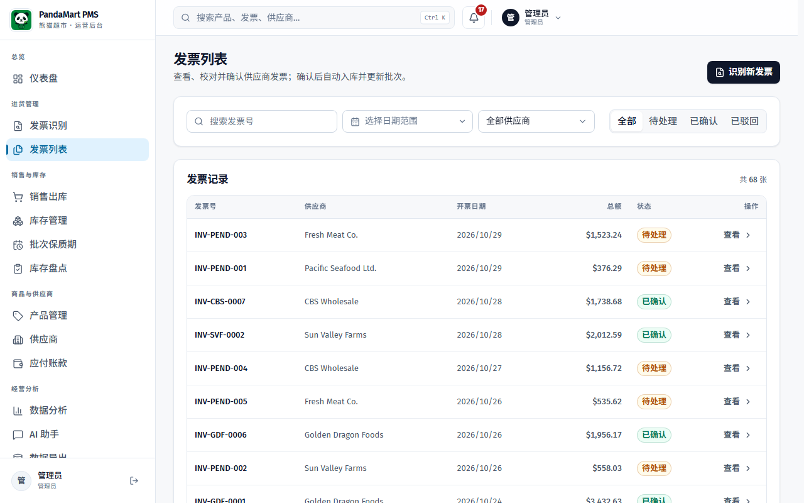

### 筛选和搜索

页面顶部提供筛选功能：
- **状态筛选** — 管理员可选择"全部 / 待处理 / 已确认 / 已驳回"；店员仅查看待处理发票
- **关键词搜索** — 可以搜索发票号或供应商名称
- 点击 **「查询」** 按钮应用筛选

### 发票列表说明

每行显示一张发票的信息：

| 列 | 说明 |
|---|------|
| 供应商 | 发票来自哪个供应商 |
| 发票号 | 发票编号 |
| 金额 | 发票总金额 |
| 日期 | 发票日期 |
| 状态 | 🟡 待处理 / 🟢 已确认 / 🔴 已驳回 |
| 操作 | 查看详情、修改、删除等按钮 |

### 发票状态说明

- **待处理（黄色）** — 刚上传的发票，等待管理员审核确认
- **已确认（绿色）** — 已审核通过，库存已经更新
- **已驳回（红色）** — 审核未通过（如重复发票、金额不对等）

### 查看和操作发票

点击某张发票可以：
- 📋 **查看详情** — 查看发票所有商品明细
- ✏️ **修改** — 修改识别错误的内容（仅待处理状态）
- ✅ **确认入库** — 确认发票并更新库存（仅管理员）
- ❌ **删除** — 删除错误或重复的发票（仅管理员）
- ↩️ **回滚** — 撤销已确认的发票（仅管理员，会反向扣减库存）

---

## 6. 库存管理

库存管理页面显示所有产品的当前库存状况。

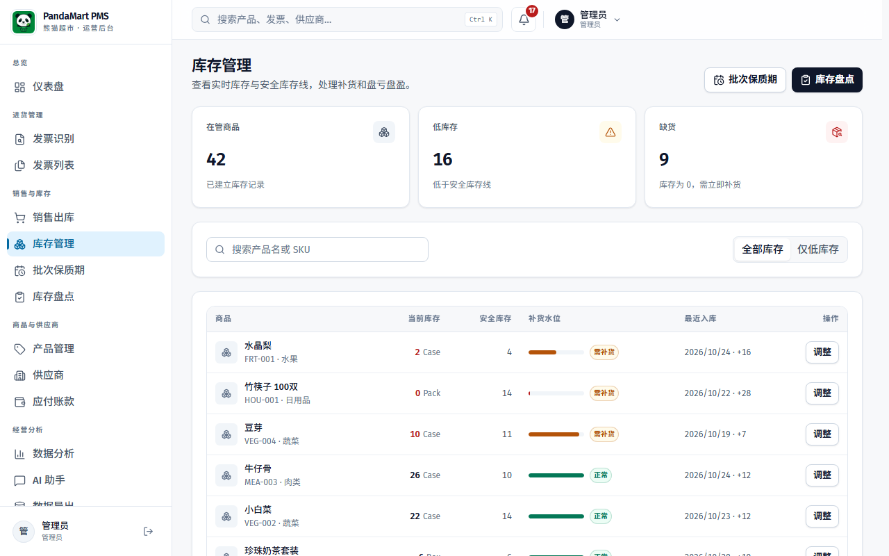

### 查看库存

页面以表格形式展示每个产品的：
- **产品名称**（中文名 + SKU 编号）
- **当前库存**（数量 + 单位）
- **安全库存**（低于此数量会报警）
- **状态** — 🟢 正常 / 🟡 低库存

### 筛选低库存产品

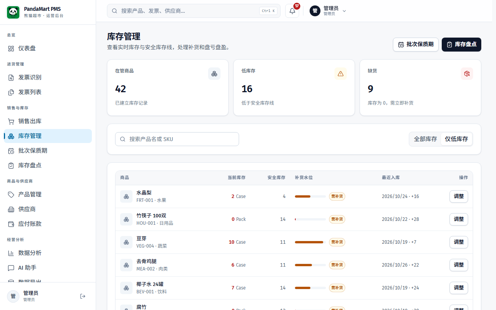

1. 勾选 **「低库存」** 复选框
2. 点击 **「查询」** 按钮
3. 系统只显示库存低于安全线的产品

### 手动调整库存

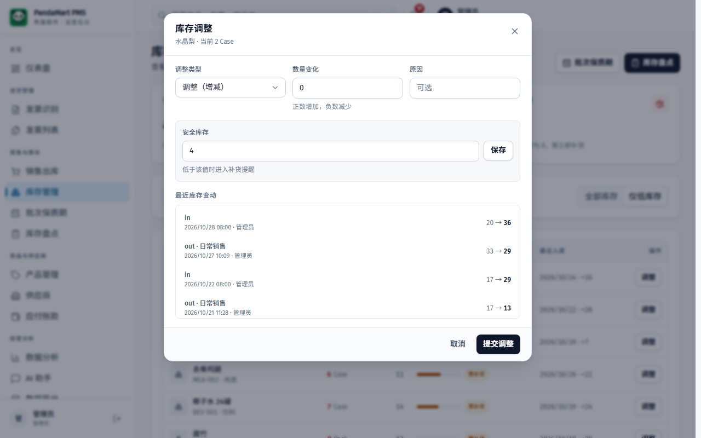

当需要手动调整库存时（例如商品损坏、退货、发现差异）：

> 该操作仅管理员可见。

1. 在表格中找到需要调整的产品，点击 **「调整」** 按钮
2. 在弹出的窗口中：
   - **类型** — 选择"调整"、"出库"或"盘点"
   - **数量变化** — 输入变化数量（正数为增加，负数为减少）
   - **原因** — 填写调整原因（如"商品损坏"、"退货"）
3. 点击 **「提交调整」** 按钮

### 设置安全库存

在调整弹窗中，管理员可以看到 **「设置安全库存」** 区域：
1. 输入安全库存数量
2. 点击 **「保存」** 按钮
3. 低于此数量时，系统会自动发出预警通知

### 查看库存日志

弹窗底部显示 **「最近库存日志」**，记录了该产品的每次变动：
- 变动时间
- 变动类型（in 入库 / out 出库 / stocktake 盘点）
- 变动数量
- 变动前后的库存数量

---

## 7. 库存盘点

库存盘点功能用于定期核对实际库存与系统库存是否一致。

**操作步骤：**

1. 点击左侧菜单的 **「库存盘点」**
2. 逐个产品清点实际库存数量
3. 对于有差异的产品，使用库存管理中的"调整"功能，选择类型为 **「盘点」**，输入实际数量与系统数量的差值
4. 填写原因为"月度盘点"或"周度盘点"

> 💡 **建议：** 每月至少进行一次全面盘点，重点关注高价值和高流转的产品。

---

## 8. 产品管理

在产品管理页面可以查看和管理所有商品信息。

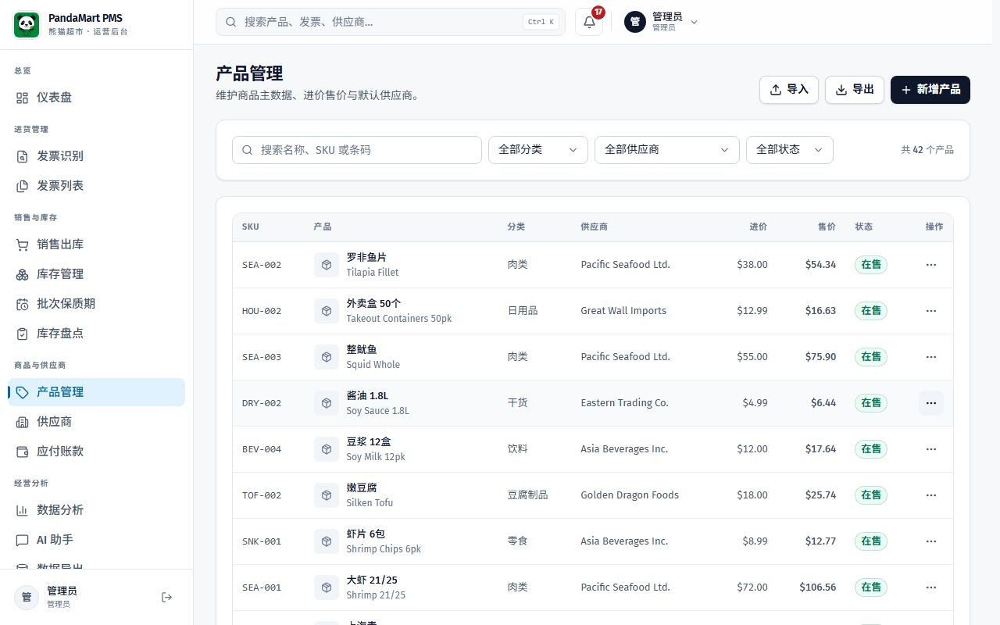

### 查看产品列表

表格显示每个产品的：
- **SKU** — 产品编号
- **名称** — 中文名 + 英文名
- **分类** — 所属分类（蔬菜、肉类、干货等）
- **供应商** — 默认供应商
- **默认价** — 最新进价（仅管理员可见）

### 搜索产品

在搜索框中输入产品名称或 SKU，点击 **「查询」** 即可快速找到产品。

### 新增产品（仅管理员）

在页面顶部的表单中填写：
1. **SKU** — 产品编号（可选）
2. **英文名** — 产品英文名称（必填）
3. **中文名** — 产品中文名称
4. **分类** — 从下拉菜单选择
5. **默认供应商** — 从下拉菜单选择
6. **默认单位** — 如 Case、Bag、Pack
7. **默认进价** — 最新采购单价
8. 点击 **「创建产品」** 按钮

### 查看价格历史

点击产品行的 **「价格历史」** 按钮，可以查看该产品每次采购的单价变化，方便比较不同时期的价格。

> 价格历史仅管理员可见。

### 导入 / 导出

- **导入 Excel** — 点击「导入 Excel」按钮，上传 Excel 格式的产品清单，批量导入
- **导出** — 点击「导出」按钮，下载当前产品列表为 Excel 文件

---

## 9. 供应商管理

管理超市合作的所有供应商信息。

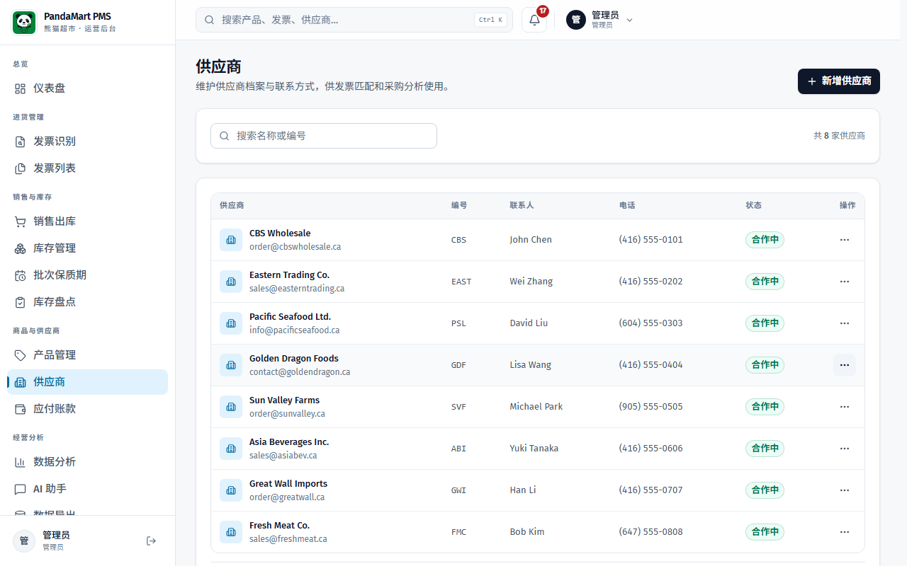

### 查看供应商

表格显示每个供应商的：名称、编号、联系人、电话

### 新增供应商（仅管理员）

1. 在页面顶部的表单中填写供应商信息
2. 点击 **「创建供应商」** 按钮

### 编辑供应商

点击供应商行的 **「编辑」** 按钮，修改信息后点击 **「保存修改」**。

### 查看供应商详情

点击 **「详情」** 按钮查看供应商的完整信息，包括地址、邮箱、备注等。

---

## 10. 数据分析

> 本页面仅管理员可见。

数据分析页面提供丰富的图表和报告，帮助管理者了解经营状况。

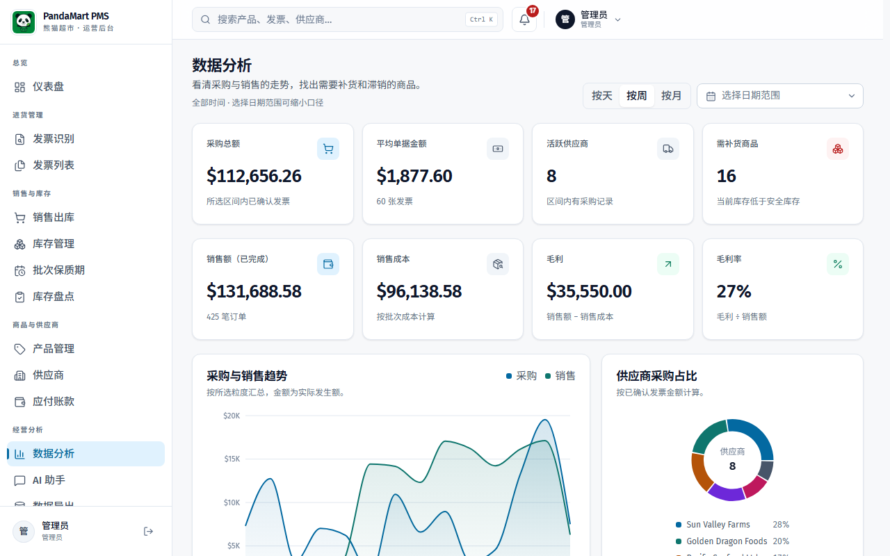

### 切换时间维度

页面顶部有一个下拉菜单，可以选择：
- **按天** — 查看每日数据
- **按周** — 查看每周数据（推荐）
- **按月** — 查看每月数据

### 采购趋势图

左侧的面积图展示一段时间内的采购金额走势。鼠标悬停在图表上可以看到具体金额。

### 供应商采购占比

右侧的饼图展示各供应商的采购金额占比。帮助了解哪些供应商是主要合作伙伴。

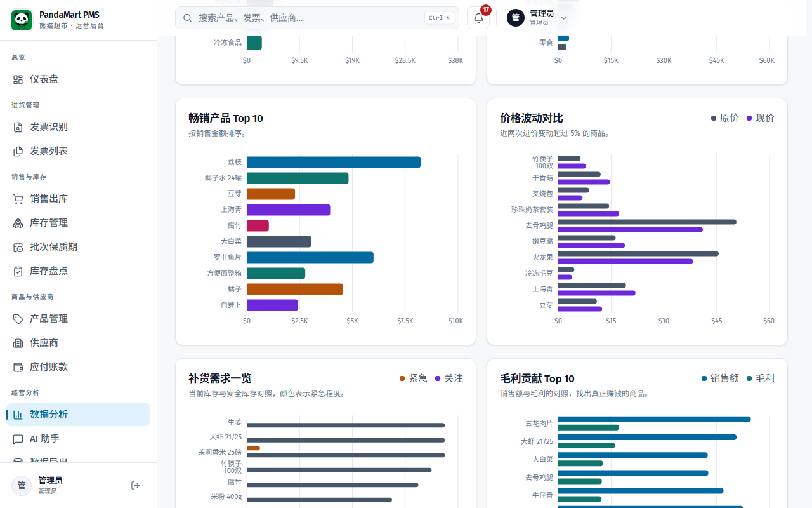

### 畅销产品 Top 10

列出采购量最大的 10 个产品，显示总数量、总金额、采购次数。

### 价格波动预警

显示价格变化幅度较大的产品：
- 🔴 **红色百分比** — 价格上涨（如 +28.2%）
- 🟢 **绿色百分比** — 价格下降（如 -15.9%）

价格波动较大时需要注意，可能是供应商调价或市场波动。

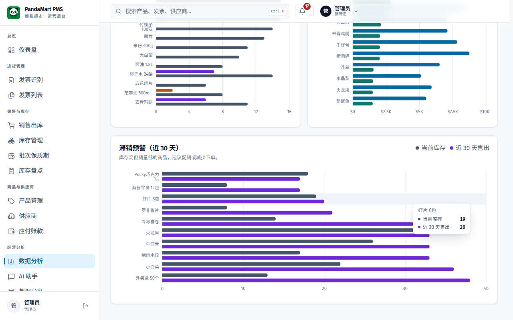

### 分类采购分布

按产品分类（蔬菜、肉类、干货等）显示采购金额占比。

### 智能订货建议

系统根据库存水平、历史消耗和安全库存，自动给出补货建议：
- **产品名称** — 需要补货的产品
- **当前库存 / 安全库存** — 库存现状
- **建议数量** — 建议采购数量
- **预估成本** — 按最新进价估算的金额
- **紧急程度** — 建议优先级（建议: X）

> 💡 **小贴士：** 每天查看一次订货建议，按紧急程度优先处理，可以有效避免缺货。

---

## 11. 智能助手

> 本页面仅管理员可见。

智能助手可以让你用日常说话的方式提问，系统会自动读取最新的仓库数据并给出**带真实数字**的回答。它有两种工作模式：

| 模式 | 需要 AI 提供商吗 | 说明 |
|------|----------------|------|
| **本地模式**（默认） | 不需要 | 用规则引擎直接查询数据库后计算答案，不联网、不花钱，每次结果一致 |
| **LLM 模式** | 需要 | 由 AI 模型理解问题、调用查询工具再用自然语言组织答案，适合更自由、更口语化的提问 |
| **自动模式** | 可选 | 配置了 AI 提供商就走 LLM，没有或调用失败时自动降级到本地模式 |

切换方式：页面顶部的「本地模式 / LLM 模式」开关。没配置 AI 提供商时，LLM 选项会置灰。也可以在 **系统设置 → 智能助手模式** 里设置默认模式。

### 11.1 资料库（系统现在知道什么）

页面右上方的「资料库」卡片显示助手当前掌握的仓库情况，包括：

- 商品总数、库存不足、零库存、即将过期（14 天内）的批次数
- 最近 1 / 7 / 30 / 90 天的销售与采购金额、单量
- 销售额最高的商品、补货建议（前 3 条）
- 应付供应商欠款、待处理发票

资料库默认缓存 60 秒（可在 **系统设置 → 资料库缓存（秒）** 调整）。入库、出库、盘点、发票确认等操作会自动让缓存失效，所以助手拿到的永远是**最新**数据。点击「刷新」可以立即重建。

### 11.2 提问

1. 点击左侧菜单的 **「智能助手」**
2. 在输入框中用日常语言提问，例如：
   - "现在哪些产品缺货了？"
   - "生姜还有多少库存？"（不用输入完整商品名，输入关键字即可）
   - "哪些商品要补货？"
   - "本月采购金额最高的供应商是谁？"
   - "现在有多少钱要付给供应商？"
   - "最近哪些商品涨价了？"
   - "有哪些发票还没处理？"
   - "这个礼拜卖得怎么样？"
3. 按回车或点击发送按钮

回答会标注使用了哪种引擎（本地 / LLM）、识别出的问题类型，以及建议的下一步问题。**LLM 模式出错时会自动用本地模式回答**，因此不会出现"助手不可用"的情况；此时回答上方会提示已降级及原因。

### 11.3 库存预警

页面左侧的「库存预警」卡片根据资料库自动生成，按严重程度排序：

- **缺货风险** — 零库存或低于安全库存
- **过期 / 临期** — 已过期或 14 天内到期的批次
- **应付账款** — 未结清金额
- **待处理发票** — 已上传但未确认的发票
- **价格波动** — 进价明显上涨的商品
- **滞销商品** — 长期没有销售的商品

每条预警都带有跳转链接，点击可直接进入对应的库存、发票或供应商页面处理。

### 11.4 报告与补货建议

页面下方的两张卡片：

- **本地模式**：「经营简报」可按周 / 月生成，包含销售、毛利、采购、热销商品和预警汇总，全部由本地数据计算。
- **LLM 模式**：由 AI 生成业务分析和文字版补货建议。

> ⚠️ **注意：** 智能助手的回答基于系统内的数据，库存数字的准确性取决于入库/出库是否及时登记。如果发现数据不对，请先检查发票和库存调整记录。

---

## 12. 通知中心

通知中心集中显示系统推送的各种预警和提醒。

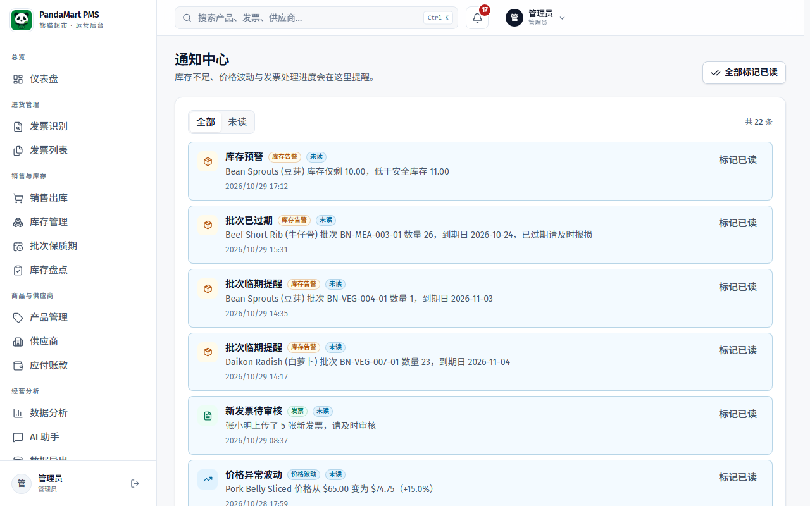

### 通知类型

| 类型 | 图标 | 说明 |
|------|------|------|
| 库存预警 | 📦 | 某产品库存低于安全线 |
| 价格异常 | 💰 | 某产品进价波动超过阈值 |
| 新发票 | 📄 | 有新发票上传等待审核 |
| 系统通知 | ⚙️ | 系统公告和提醒 |

### 操作

- 点击 **「标记已读」** 按钮将单条通知标为已读
- 点击右上角 **「全部标记已读」** 一键清除所有未读
- 未读通知数量会显示在顶栏的铃铛图标旁边

> 💡 **建议：** 每天登录后先查看通知中心，特别关注库存预警和价格异常通知。

---

## 13. 系统设置（仅管理员）

系统设置页面用于配置系统参数。

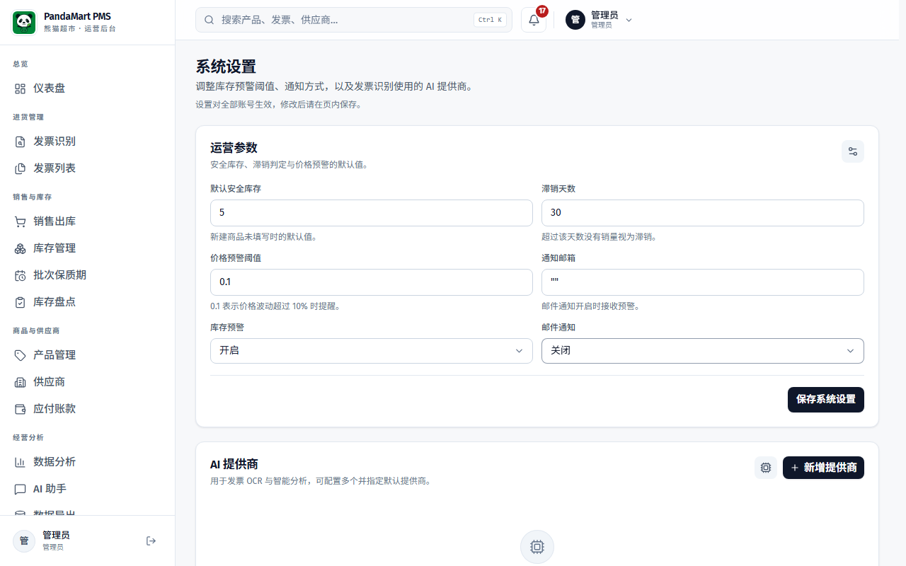

### 可配置项

- **价格波动阈值** — 当产品进价变化超过此百分比时，系统会发出预警通知（默认 10%）
- **发票识别模式** — 自动 / 仅本地 / LLM 优先；页面会显示本地 OCR 是否可用
- **智能助手模式** — 本地资料库 / LLM / 自动
- **AI 提供商配置** — 可选；仅在 LLM 模式、低置信度识别或 AI 兜底时使用

### 发票识别模式

- **自动** — 先尝试本地解析与本地 OCR，结果不确定时才调用 AI（推荐）
- **仅本地** — 不调用任何 AI；需要服务器安装 Tesseract 和 poppler
- **LLM 优先** — 原来的 AI 优先流程

> 本地 OCR 状态显示「Tesseract x.x · eng+chi_sim」表示可用；显示「未安装」时请联系管理员运行 `scripts/install-ocr-deps.sh`。PDF 文本和 Excel 不依赖本地 OCR。

### AI 提供商设置（可选）

1. 进入 **系统设置** 或 **AI 提供商** 页面
2. 添加 AI 提供商信息：
   - **名称** — 给 AI 提供商取个名字
   - **接口地址** — AI 服务的 API 地址
   - **API Key** — API 密钥
   - **模型名称** — 使用的 AI 模型
   - **用途** — OCR（发票识别）/ 分析 / 聊天 / 全部
3. 点击 **「测试连接」** 验证配置是否正确
4. 设置为默认提供商

---

## 14. 用户管理（仅管理员）

管理系统的用户账户。

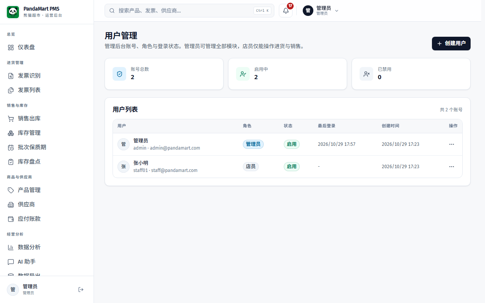

### 用户角色

系统有两种用户角色：

| 角色 | 权限 |
|------|------|
| **管理员（Admin）** | 所有功能，包括仪表盘、智能助手、数据分析、价格历史、确认发票、管理产品/供应商/用户、系统设置 |
| **员工（Staff）** | 上传发票、查看和处理待处理发票、查看库存、查看产品/供应商基础信息 |

### 添加新用户

1. 填写用户名、显示名称、邮箱
2. 设置初始密码
3. 选择角色（管理员或员工）
4. 点击创建

### 管理现有用户

- 编辑用户信息
- 重置密码
- 禁用/启用账户

---

## 15. 常见问题

### Q: 上传发票后一直在转圈，怎么办？
**A:** 本地 OCR 通常几秒到几十秒；如果启用了 AI 或本地识别失败后转 AI，可能需要 30 秒到 2 分钟，图片格式更久。超过 3 分钟没有结果，可能是网络问题或识别服务异常，请刷新页面重试。

### Q: 没有 AI API Key，能用发票识别吗？
**A:** 可以。系统默认「自动」模式：Excel、文本 PDF 和图片/扫描件都优先走本地解析与本地 OCR，不需要 API Key。只有本地置信度低且配置了 AI 提供商时才调用 AI。

### Q: 发票识别的内容不准确怎么办？
**A:** 本地 OCR 和 AI 都并非 100% 准确，特别是模糊的扫描件。你可以：
1. 查看页面上的「置信度」和「提示」，重点核对低置信度的明细
2. 直接在识别结果页面手动修改错误的字段
3. 重新拍一张更清晰、摆正的照片上传
4. 优先使用带文字层的 PDF 或 Excel（准确率最高）

### Q: 确认入库后发现有错误怎么办？
**A:** 管理员可以使用「回滚」功能：
1. 在发票列表找到该发票
2. 点击查看详情
3. 点击「回滚未确认」按钮
4. 系统会自动扣减库存，发票恢复为待处理状态
5. 修改后重新确认入库

### Q: 安全库存应该设置多少？
**A:** 建议根据产品的日均销量和补货周期来设置：
- **安全库存 = 日均销量 × 补货天数 × 1.5**
- 例如：大白菜每天卖 2 箱，补货需要 3 天，安全库存 = 2 × 3 × 1.5 = 9 箱
- 热销产品可以适当提高倍数

### Q: 页面显示"加载失败"怎么办？
**A:** 可能的原因和解决方法：
1. **网络断开** — 检查网络连接
2. **登录过期** — 刷新页面重新登录
3. **服务器维护** — 联系管理员确认系统状态

### Q: 如何退出系统？
**A:** 点击页面右上角的 **「退出」** 按钮即可安全退出。

---

## 日常工作流程建议

### 每天必做

1. ✅ **登录系统**
   管理员优先查看仪表盘和通知；店员优先进入「发票识别」或「发票列表」处理待处理发票
2. ✅ **检查通知** — 处理库存预警和价格异常提醒（管理员）
3. ✅ **上传当日发票** — 收到供应商发票后尽快上传识别
4. ✅ **核对待处理发票** — 校对识别结果并完成确认入库

### 每周建议

1. 📊 **查看数据分析** — 了解本周采购趋势和价格波动
2. 📋 **检查订货建议** — 按建议补货，避免缺货
3. 🔍 **重点关注低库存产品** — 特别是标记为"紧急"的补货建议

### 每月建议

1. 📦 **进行库存盘点** — 核对实际库存与系统记录
2. 📈 **查看月度报告** — 分析采购金额、价格变化趋势
3. 🏪 **评估供应商** — 对比供应商的价格和供货情况

---

> 📞 **技术支持：** 如遇系统问题，请联系系统管理员  
> 📅 **文档版本：** 2026 年 3 月 · PandaMart PMS v1.0
